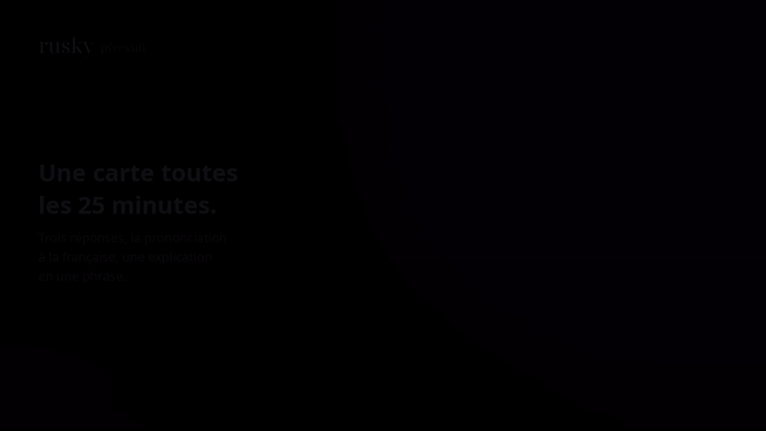
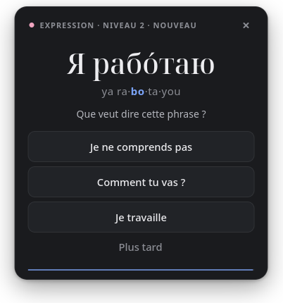
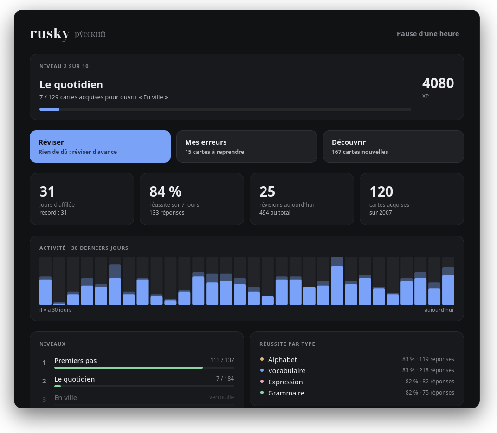

<div align="center">

# rusky

**Apprendre le russe par petites touches, sans y penser.**<br>
Toutes les 25 minutes, une carte apparaît dans un coin de l'écran : trois réponses, la prononciation à la française, une explication en une phrase.

[](https://github.com/Ybucaille/Rusky/actions/workflows/ci.yml)
[](Cargo.toml)
[](https://gtk.org)
[](#installation-arch-linux)
[](#les-10-niveaux)
[](LICENSE)

[Installation](#installation-arch-linux) · [Les 10 niveaux](#les-10-niveaux) · [Utilisation](#utilisation) · [Tes cartes](#ajouter-tes-propres-cartes)

<a href="docs/demo.mp4"></a>

<sub>Une vraie session, filmée hors écran par rusky lui-même (base de démonstration avec un mois d'historique). <a href="docs/demo.mp4">MP4 avec musique</a>.</sub>

</div>

## Pourquoi rusky

- **Sans effort de volonté.** Les cartes viennent à toi pendant que tu travailles ; une réponse prend cinq secondes.
- **2 007 cartes sur 10 niveaux**, du premier alphabet jusqu'à l'argot, aux proverbes et aux sous-entendus qu'un natif seul entend.
- **Lisible dès le premier jour.** Chaque mot russe a sa prononciation à la française, calculée depuis l'accent tonique : молоко́ → ma·la·**ko**.
- **Choix multiple**, verdict immédiat et explication sans jargon.
- **XP et niveaux** qui s'ouvrent quand tu maîtrises le précédent, et une répétition espacée façon Anki.
- **Une fenêtre de révision** : statistiques, activité sur 30 jours, points faibles, sessions à la demande.

<p align="center">
  
  &nbsp;
  
</p>

## Les 10 niveaux

| Niveau | Thème | Cartes |
|---|---|---|
| 1 | Premiers pas : l'alphabet complet (33 lettres), les premiers mots | 137 |
| 2 | Le quotidien : nombres, jours, repas, famille, couleurs | 184 |
| 3 | En ville : transports, courses, restaurant, demander son chemin | 165 |
| 4 | Raconter : le passé, le corps, la météo, les sentiments | 163 |
| 5 | Discuter : avis, travail, études, loisirs, métiers, cuisine | 273 |
| 6 | Nuances : expressions idiomatiques, proverbes, préfixes | 156 |
| 7 | Approfondir : paires de verbes, maison, nature, voyage, numérique | 335 |
| 8 | Aisance : société, émotions fines, registre soutenu | 229 |
| 9 | Maîtrise : langue littéraire, diminutifs, tournures idiomatiques | 183 |
| 10 | Comme un natif : argot, particules, faux amis, culture, sous-entendus | 182 |

## Installation (Arch Linux)

```bash
./install.sh
```

Le script construit le paquet, l'installe et lance le service. Variantes : `./install.sh --cargo` (sans sudo, binaire dans `~/.cargo/bin`) et `./install.sh --uninstall` (ta progression est conservée).

Il faut un compositeur Wayland qui gère `wlr-layer-shell` (Hyprland, Sway, niri…). Hors session systemd graphique, ajoute `exec-once = rusky run` à ta config Hyprland.

## Utilisation

**La popup** arrive toute seule. Clique sur une réponse : elle passe au vert ou au rouge, l'explication s'affiche, puis « Continuer ». « Plus tard », ✕ ou Échap la ferment sans noter. Sans réponse, elle se referme au bout de 45 s : la fine barre en bas montre le temps restant et se met en pause sous la souris.

**La fenêtre de révision** s'ouvre avec `rusky` tout court, ou depuis le lanceur d'applications :

- niveau en cours, XP et progression vers le niveau suivant ;
- série de jours, réussite sur 7 jours, révisions, cartes acquises ;
- activité des 30 derniers jours, réussite par type de carte, cartes à retravailler ;
- trois sessions de 10 cartes : **Réviser** (les cartes dues, ou d'avance), **Mes erreurs**, **Découvrir**.

Au clavier : `1` `2` `3` pour répondre, Entrée pour continuer, Échap pour arrêter. Tant que la fenêtre est ouverte, aucune popup ne vient l'interrompre.

## Commandes

| Commande | Effet |
|---|---|
| `rusky` | Ouvre la fenêtre de révision (aussi `rusky revision`) |
| `rusky now` | Une carte tout de suite |
| `rusky review -c 20` | Le même quiz dans le terminal |
| `rusky stats` | Progression dans le terminal |
| `rusky pause 60` | Pause d'une heure (`rusky resume` pour reprendre) |
| `rusky add "сыр" "fromage"` | Ajoute ta carte (`-n` explication, `-p` prononciation, `-k phrase`…) |
| `rusky import mes-cartes.toml` | Importe un paquet de cartes |
| `rusky run` | Le démon (lancé par le service) |
| `rusky paths` | Où sont la config et la base |

Astuce Hyprland : `bind = SUPER, R, exec, rusky now` pour une carte à la demande.

## Niveaux et XP

Une bonne réponse rapporte 10 XP, une erreur 2 (l'effort compte). Une carte est **acquise** quand tu l'as réussie deux fois d'affilée. Le niveau suivant s'ouvre quand 70 % des cartes du niveau en cours sont acquises, et une popup te prévient. Les nouvelles cartes ne viennent que des niveaux ouverts, et les mauvaises réponses proposées sont tirées des niveaux voisins.

## Comment marche la répétition

- Bonne réponse : la carte revient dans 4 h, puis 1 jour, 3 jours, puis l'intervalle est multiplié (×2,5 au départ).
- Mauvaise réponse : elle revient dans 10 minutes et deviendra un peu plus fréquente.
- Une fois connue, une carte de vocabulaire ou d'expression est parfois posée à l'envers (français → russe).

## Configuration

`~/.config/rusky/config.toml`, relu à chaque popup :

```toml
interval_minutes = 25   # écart entre deux popups
active_start = 9        # pas de popups avant 9 h
active_end = 23         # ni après 23 h (peut passer minuit : 18 → 2)
max_new_per_day = 8     # nouvelles cartes par jour (popups)
kinds = ["alphabet", "vocab", "grammar", "phrase"]
```

Les données sont dans `~/.local/share/rusky/rusky.db` (SQLite). La variable `RUSKY_DB` permet d'utiliser une autre base, pour essayer sans toucher à sa progression.

## Ajouter tes propres cartes

```toml
[[card]]
id = "perso-cuisine-001"   # unique, sert à garder ta progression
kind = "vocab"             # alphabet | vocab | grammar | phrase
front = "сыр"
back = "fromage"
note = "Я люблю́ сыр = J'aime le fromage."
tier = 2                   # niveau (1 par défaut)
# Optionnels : pron = "…" pour corriger la prononciation calculée,
# question = "…" (la consigne), wrong = ["…", "…"] (les mauvaises réponses).
```

Puis `rusky import mes-cartes.toml`. Réimporter met à jour le texte sans perdre la progression. L'accent tonique (´) se tape avec la touche morte, ou se copie-colle.

## Modifier le paquet intégré

Chaque niveau s'écrit dans `data/src/niveau-N.txt`, une carte par ligne (`russe accentué | sens | note`), puis se convertit :

```bash
python3 data/src/build.py data/src/niveau-2.txt data/niveau-2.toml t2
```

Le script refuse un mot de plusieurs syllabes sans accent, une lettre latine glissée dans un mot russe, un doublon ou une question de grammaire mal formée. `cargo test` vérifie ensuite le paquet entier.

## Refaire la vidéo

```bash
python3 scripts/make-demo.py --db chemin/vers/une-base-de-demo.db
```

rusky est compilé avec l'option `demo` et filme lui-même ses fenêtres hors écran (rien du bureau n'apparaît), puis le script compose les scènes, ajoute la musique et écrit `docs/demo.mp4` et `docs/demo.gif`.

## Licence

[MIT](LICENSE)
